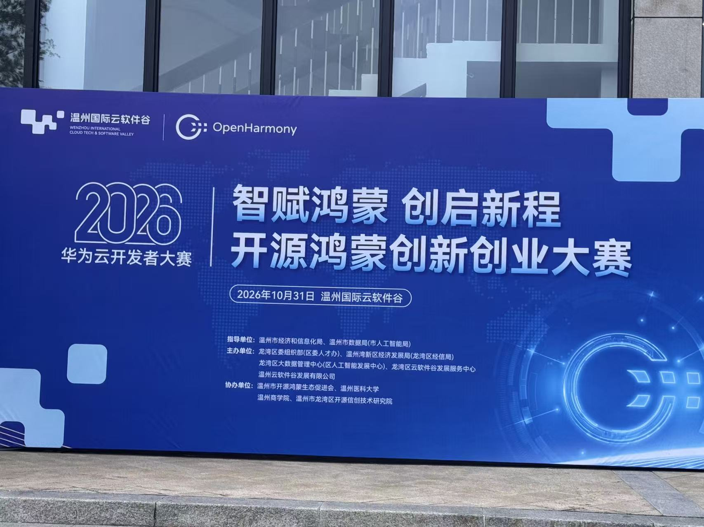

# 华为云开发者大赛暨“智赋鸿蒙 创启新程”开源鸿蒙创新创业大赛

## 基本信息

| 项目 | 内容 |
| --- | --- |
| 时间 | 2026 年 |
| 类型 | 竞赛 |
| 指导单位 | 温州市经信局、温州市龙湾区人民政府 |
| 主办单位 | 区委组织部、温州市湾新区经济发展局（温州市龙湾区经信局）、温州国际云软件谷 |
| 协办单位 | 温州市开源鸿蒙生态促进会、温州市龙湾区开源信创技术研究院 |
| 参赛方向 | 产品鸿蒙化 —— 存量硬件鸿蒙升级改造 |
| 参赛项目 | 基于 OpenHarmony 的存量工业设备只读采集网关 |
| 成果 | 技术计划书、路演材料、端到端联调与自动验收 |
| 奖项 | 待补充 |

## 项目一句话

在不改动原控制回路的前提下，为泵阀、低压电气、汽摩配等存量工业设备外挂一枚 Hi3861（OpenHarmony 轻量系统）采集模组，通过 RS485 / Modbus RTU 只读采集运行数据，经 Wi-Fi + MQTT 上报到本地运维看板。

## 技术关键词

`OpenHarmony` `Hi3861` `Modbus RTU` `RS485` `MQTT` `只读采集` `三层解耦` `CRC16`

## 文件导航

| 文件 | 说明 |
| --- | --- |
| [01-项目介绍.md](01-项目介绍.md) | 面向展示的项目简介：背景、方案、亮点、边界 |
| [02-展示材料/路演-技术架构.pdf](02-展示材料/路演-技术架构.pdf) | 路演技术架构材料（21 页） |
| [04-赛事资料/技术计划书.docx](04-赛事资料/技术计划书.docx) | 参赛技术计划书原件 |
| [04-赛事资料/大赛通知.docx](04-赛事资料/大赛通知.docx) | 主办方赛事通知原件 |
| [04-赛事资料/报名表.xlsx](04-赛事资料/报名表.xlsx) | 路演遴选活动报名表原件 |

## 现场记录

|  |  |
| --- | --- |
|  |  |

## 收录说明

- 演示录屏（无 RS485 时的软件模拟、最终流程模拟）体积较大，未收录进本仓库。
- 项目源码不在本仓库，源码仓库链接：待补充。
